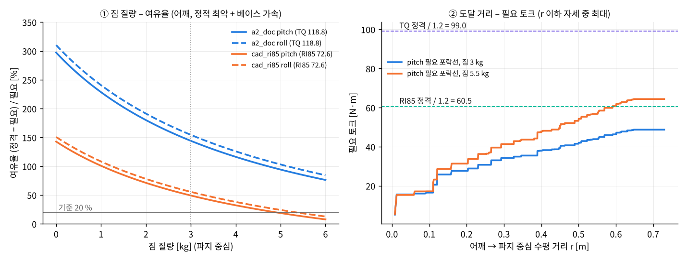

# 토크 결정 자료 (week10, 함태훈) — 자동 생성 `w10_torque_decision.py`

- 출처: 구동기 정격 · 피크 = **A2 구동기 사양서 2026-10-19 판**(TQ 118.8 / 381.7, RI85 72.6 / 181.5 N·m). 값은 모두 `config/params.yaml`
- **여유율 = (정격 − 필요) ÷ 필요, 기준 20 % 이상**(⇔ 정격 ≥ 필요 × 1.2 = 요구 정격). 비교 대상은 정격, 피크는 같이 적기만 함. 5 · 6주차 「정격 대비 %」 · 8주차 「PDR 52 기준 %」 표기는 쓰지 않음
- 필요 토크 = 정적 최악(왼팔 무작위 3,000 자세, rng 0) + 베이스 설계 가속 추가분(1 m/s² · 1.57 rad/s², 7주차 add_at_worst), 짐 @ 파지 중심(ee − 45 mm), 그리퍼 0.9 kg — 8주차와 같은 방법(3 kg 필요 48.69 · 46.71 = 8주차 표)

## 1. 어깨 case 2개 × 짐 0 · 1 · 2 · 3 kg — 필요 토크 · 여유율

| 짐 kg | 관절 | 필요 N·m | 요구 정격 (× 1.2) | **a2_doc** 정격 / 피크 → 여유율 | **cad_ri85** 정격 / 피크 → 여유율 | 참고: 자세별 실제 가속 |
|---|---|---|---|---|---|---|
| 0 | shoulder_pitch | 29.92 | 35.9 | TQ 118.8 / 381.7 → **297.1 %** | RI85 72.6 / 181.5 → **142.7 %** | 27.96 |
| 0 | shoulder_roll | 28.97 | 34.76 | TQ 118.8 / 381.7 → **310.1 %** | RI85 72.6 / 181.5 → **150.6 %** | 25.1 |
| 0 | shoulder_yaw | 5.18 | 6.21 | TQ 118.8 / 381.7 → **2195.6 %** | RI85 72.6 / 181.5 → **1302.9 %** | 4.36 |
| 0 | elbow | 5.48 | 6.58 | RI85 72.6 / 181.5 → **1223.8 %** | RI85 72.6 / 181.5 → **1223.8 %** | 4.3 |
| 1 | shoulder_pitch | 36.17 | 43.41 | TQ 118.8 / 381.7 → **228.4 %** | RI85 72.6 / 181.5 → **100.7 %** | 34.26 |
| 1 | shoulder_roll | 34.88 | 41.86 | TQ 118.8 / 381.7 → **240.6 %** | RI85 72.6 / 181.5 → **108.1 %** | 31.12 |
| 1 | shoulder_yaw | 8.54 | 10.25 | TQ 118.8 / 381.7 → **1291.2 %** | RI85 72.6 / 181.5 → **750.2 %** | 7.74 |
| 1 | elbow | 8.86 | 10.63 | RI85 72.6 / 181.5 → **719.8 %** | RI85 72.6 / 181.5 → **719.8 %** | 7.71 |
| 2 | shoulder_pitch | 42.43 | 50.92 | TQ 118.8 / 381.7 → **180.0 %** | RI85 72.6 / 181.5 → **71.1 %** | 40.56 |
| 2 | shoulder_roll | 40.79 | 48.95 | TQ 118.8 / 381.7 → **191.2 %** | RI85 72.6 / 181.5 → **78.0 %** | 37.14 |
| 2 | shoulder_yaw | 11.9 | 14.29 | TQ 118.8 / 381.7 → **898.0 %** | RI85 72.6 / 181.5 → **509.9 %** | 11.13 |
| 2 | elbow | 12.23 | 14.67 | RI85 72.6 / 181.5 → **493.7 %** | RI85 72.6 / 181.5 → **493.7 %** | 11.11 |
| 3 | shoulder_pitch | 48.69 | 58.43 | TQ 118.8 / 381.7 → **144.0 %** | RI85 72.6 / 181.5 → **49.1 %** | 46.86 |
| 3 | shoulder_roll | 46.71 | 56.05 | TQ 118.8 / 381.7 → **154.4 %** | RI85 72.6 / 181.5 → **55.4 %** | 43.17 |
| 3 | shoulder_yaw | 15.27 | 18.32 | TQ 118.8 / 381.7 → **678.1 %** | RI85 72.6 / 181.5 → **375.5 %** | 14.52 |
| 3 | elbow | 15.6 | 18.72 | RI85 72.6 / 181.5 → **365.4 %** | RI85 72.6 / 181.5 → **365.4 %** | 14.52 |

- 모든 칸 20 % 이상 → **두 case 모두 짐 0 ~ 3 kg 전 구간 통과**. 가장 빠듯한 곳 = cad_ri85 shoulder_pitch 3 kg 49.1 %
- 「참고: 자세별 실제 가속」 = 같은 자세에서 |τ_중력| + |τ_베이스가속| 최대(3 kg pitch 46.86) — 8주차 방법(최악 자세 정적 + 다른 자세의 가속 최대분 합)이 3.9 % 더 보수적. 판정은 팀장 승인 값(8주차 방법) 유지

### 집기 시나리오(동적) 짐 스윕 — 박종진 전문가 정책, 옆면 접근, seed 1000 ~ 1009, dt 0.5 ms (`w10_scenario_sweep.py`)

| 짐 kg | 성공 | 잡기 ~ 놓기 구동 토크 최대 pitch · roll · yaw · elbow [N·m] |
|---|---|---|
| 0.2 | 10/10 | 2.75 · 3.27 · 2.12 · 0.84 |
| 1 | 10/10 | 4.59 · 4.3 · 2.19 · 0.85 |
| 2 | 10/10 | 7.23 · 6.52 · 2.17 · 1.63 |
| 3 | 9/10 | 9.83 · 8.69 · 2.19 · 2.35 |

- 시나리오 실제 토크는 정적 최악의 20 % 수준(3 kg pitch 9.83 vs 48.69) — 옆면 접근이라 팔이 거의 수직. 짐에 거의 선형(0.2 → 3 kg: 2.75 → 9.83, 약 2.5 N·m/kg ≈ g × 0.26 m). 3 kg 실패 1건(seed 1003 낙하)은 8주차와 같은 seed

## 2. 20 % 를 만족하는 최대 짐 m_max — 선형식 vs 자세 스윕

| 구동기 | 관절 | 필요 한도 = 정격 ÷ 1.2 | τ₀ (짐 0, 3 kg 최악 자세) | r (= Sz ÷ g) | **선형식** m = (한도 − τ₀) ÷ (g · r) | **자세 스윕** | 3 kg 최악 자세 (°) |
|---|---|---|---|---|---|---|---|
| TQ | shoulder_pitch | 99.0 | 29.92 | 0.638 m | **11.04 kg** | **11.04 kg** | [90.4, 5.4, -113.3, 9.1] |
| TQ | shoulder_roll | 99.0 | 28.97 | 0.603 m | **11.84 kg** | **11.84 kg** | [-5.7, 81.5, -99.9, -22.8] |
| RI85 | shoulder_pitch | 60.5 | 29.92 | 0.638 m | **4.89 kg** | **4.88 kg** | [90.4, 5.4, -113.3, 9.1] |
| RI85 | shoulder_roll | 60.5 | 28.97 | 0.603 m | **5.33 kg** | **5.33 kg** | [-5.7, 81.5, -99.9, -22.8] |

- 선형식과 스윕 차 ≤ 0.01 kg — 짐 0 ~ 15 kg 에서 최악 자세가 바뀌지 않아서(팔 수평, 짐 · 팔 무게가 같은 방향). 정적 토크가 짐에 선형인 이유 = τ = τ₀(q) + m · g · J_zᵀ(q), 같은 자세면 m 의 1차식
- 선형이 깨지는 경우: 가감속(τ = M(q) q̈ 에 짐 관성이 들어가고 궤적 속도 · 시간에 따라 최악 자세가 바뀜), 접촉 · 충격(파지력 · 놓을 때 튐, 7주차 32 mm), 짐이 손 안에서 미끄러져 r 이 바뀔 때
- 짐 제한이 필요한 질량: RI85 어깨면 4.88 kg 초과, TQ 면 11.04 kg 초과 → **목표 3 kg 에서는 짐 제한 불필요**

## 3. 최대 도달 거리 r_max — 어깨 pitch 관절점 → 파지 중심 수평 거리

- 3,000 자세의 r 범위 0.008 ~ **0.729 m**(최대 도달). r 이하 자세들의 필요 토크 최대(포락선)가 정격 ÷ 1.2 이하인 r 의 상한

| 구동기 | 짐 kg | r_max | 도달 제한 필요? |
|---|---|---|---|
| TQ | 3 | 0.729 m | 아니오 (최대 도달까지 OK) |
| TQ | 6 | 0.729 m | 아니오 (최대 도달까지 OK) |
| TQ | 9 | 0.729 m | 아니오 (최대 도달까지 OK) |
| TQ | 11 | 0.729 m | 아니오 (최대 도달까지 OK) |
| TQ | 12 | 0.601 m | **예** |
| TQ | 13 | 0.569 m | **예** |
| RI85 | 3 | 0.729 m | 아니오 (최대 도달까지 OK) |
| RI85 | 4 | 0.729 m | 아니오 (최대 도달까지 OK) |
| RI85 | 4.5 | 0.729 m | 아니오 (최대 도달까지 OK) |
| RI85 | 5 | 0.63 m | **예** |
| RI85 | 5.5 | 0.591 m | **예** |
| RI85 | 6 | 0.553 m | **예** |

- 손 검산(RI85 5 kg): 팔 자중 토크 ≈ 27.76 N·m × (r ÷ 0.638) + 5 g r ≤ 60.5 − 2.16 → r ≤ 58.34 ÷ (43.5 + 49.1) = **0.630 m** = 스윕 0.630 m
- 손 검산(앞으로 수평): r = 0.651 m, 3 kg 짐 몫 3 g r = 19.15 vs 시뮬 18.84 N·m(차 1.6 % — 그리퍼 축 45 mm 오프셋 · 어깨 roll 축 위치)
- 주의: 정확히 앞으로 수평(pitch −90°, 나머지 0) 자세의 3 kg pitch 필요 = 48.85 N·m 로 3,000 무작위 자세 최대 48.69 보다 0.3 % 큼(무작위 표본이 정확한 최악점을 빗겨감). 이 값으로 쓰면 RI85 여유 48.6 % · m_max ≈ 4.86 kg — 결론 같음. CDR 동결 때는 6주차처럼 국소 최적화로 최악점을 잡아 고정할 것
- **목표 3 kg 에서는 두 case 모두 r_max = 최대 도달 → 도달 제한 불필요**. 박종진 wb_ik `reach_limit` 값 = `results/reach_limit_w10.json`(짐별 표, RI85 5 kg 이면 0.63 m)

## 4. 결정 자료 (A팀 회신 양식)

| 방안 | 어깨 case | 짐 질량 | 최소 여유율 (필요 대비) | 집기 성공률 | 잃는 것 |
|---|---|---|---|---|---|
| 현재 (제한 없음) | a2_doc | 3 kg | 144.0 % (shoulder_pitch) | 9/10 (3 kg, seed 1000 ~ 1009) · 8주차 19/20 | — |
| ① 짐 제한 | a2_doc | m_max 11.04 kg | 20.0 % (m_max 에서 정의상) | 3 kg 이 m_max 아래 → 제한 걸리지 않음(현재와 같음) | 없음 (3 kg < 11.04 kg) |
| ② 도달 제한 | a2_doc | 3 kg | 144.0 % (r_max = 전 도달 0.729 m) | 도달 제한 걸리지 않음(현재와 같음) | 없음 (3 kg 에서 r_max = 최대 도달) |
| 손목 2축 추가 (예측) | a2_doc | 3 kg | pitch 127 ~ 119 · roll 136 ~ 128 % (지금 대비 −17 ~ −25 %p) | 예측 (박종진) | 여유율 감소, 그래도 20 % 이상 |
| 현재 (제한 없음) | cad_ri85 | 3 kg | 49.1 % (shoulder_pitch) | 9/10 (3 kg, seed 1000 ~ 1009) · 8주차 19/20 | — |
| ① 짐 제한 | cad_ri85 | m_max 4.88 kg | 20.0 % (m_max 에서 정의상) | 3 kg 이 m_max 아래 → 제한 걸리지 않음(현재와 같음) | 없음 (3 kg < 4.88 kg) |
| ② 도달 제한 | cad_ri85 | 3 kg | 49.1 % (r_max = 전 도달 0.729 m) | 도달 제한 걸리지 않음(현재와 같음) | 없음 (3 kg 에서 r_max = 최대 도달) |
| 손목 2축 추가 (예측) | cad_ri85 | 3 kg | pitch 38 ~ 34 · roll 44 ~ 39 % (지금 대비 −11 ~ −15 %p) | 예측 (박종진) | 여유율 감소, 그래도 20 % 이상 |

- **권고(함태훈 의견): 「현재(제한 없음) + 짐 3 kg」 유지.** 근거 — 두 case 모두 3 kg 최소 여유 49.1 %(RI85) 이상, m_max 4.88 kg · r_max = 최대 도달이라 ① · ② 는 걸리지 않음. 손목 2축을 달아도 RI85 34 ~ 38 % 로 기준 위
- 그래도 ① · ② 는 `config/params.yaml` limits 플래그로 구현(기본 꺼짐) — 짐 사양이 4.9 kg 이상으로 오르거나(RI85), 하체 가속 사양이 커지면 켠다
- 어깨 case 선택은 토크로 갈리지 않음 → 질량 · 비용 · 납기로 결정 가능(팀장 · A팀)

